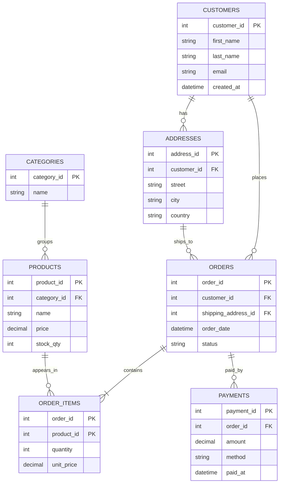

# E-commerce Database: ERD

A small e-commerce schema in 3NF. 


## Relationships

| Relationship | Type | How it is stored |
|---|---|---|
| Customer → Addresses | One-to-many | `addresses.customer_id` |
| Customer → Orders | One-to-many | `orders.customer_id` |
| Address → Orders | One-to-many | `orders.shipping_address_id` |
| Category → Products | One-to-many | `products.category_id` |
| Order → Payments | One-to-many | `payments.order_id` (allows split or retried payments) |
| Orders ↔ Products | **Many-to-many** | junction table `order_items` |

## Design decisions

- **Junction table:** `order_items` resolves the orders-to-products many-to-many. Its primary key is the pair `(order_id, product_id)`.
- **`unit_price` stored on `order_items`:** this is deliberate. It records the price at the time of purchase, so later changes to `products.price` don't rewrite history.
- **3NF:** customer details live in `customers`, category names in `categories`, and shipping details in `addresses`, so each fact is stored once.

## SQL (SQLite)

```sql
PRAGMA foreign_keys = ON;

CREATE TABLE customers (
    customer_id INTEGER PRIMARY KEY,
    first_name  TEXT NOT NULL,
    last_name   TEXT NOT NULL,
    email       TEXT NOT NULL UNIQUE,
    created_at  TEXT DEFAULT CURRENT_TIMESTAMP
);

CREATE TABLE addresses (
    address_id  INTEGER PRIMARY KEY,
    customer_id INTEGER NOT NULL REFERENCES customers(customer_id),
    street      TEXT NOT NULL,
    city        TEXT NOT NULL,
    country     TEXT NOT NULL
);

CREATE TABLE categories (
    category_id INTEGER PRIMARY KEY,
    name        TEXT NOT NULL UNIQUE
);

CREATE TABLE products (
    product_id  INTEGER PRIMARY KEY,
    category_id INTEGER NOT NULL REFERENCES categories(category_id),
    name        TEXT NOT NULL,
    price       NUMERIC NOT NULL CHECK (price >= 0),
    stock_qty   INTEGER NOT NULL DEFAULT 0
);

CREATE TABLE orders (
    order_id            INTEGER PRIMARY KEY,
    customer_id         INTEGER NOT NULL REFERENCES customers(customer_id),
    shipping_address_id INTEGER NOT NULL REFERENCES addresses(address_id),
    order_date          TEXT DEFAULT CURRENT_TIMESTAMP,
    status              TEXT NOT NULL DEFAULT 'pending'
);

CREATE TABLE order_items (
    order_id   INTEGER NOT NULL REFERENCES orders(order_id),
    product_id INTEGER NOT NULL REFERENCES products(product_id),
    quantity   INTEGER NOT NULL CHECK (quantity > 0),
    unit_price NUMERIC NOT NULL,
    PRIMARY KEY (order_id, product_id)
);

CREATE TABLE payments (
    payment_id INTEGER PRIMARY KEY,
    order_id   INTEGER NOT NULL REFERENCES orders(order_id),
    amount     NUMERIC NOT NULL,
    method     TEXT NOT NULL,
    paid_at    TEXT
);
```

